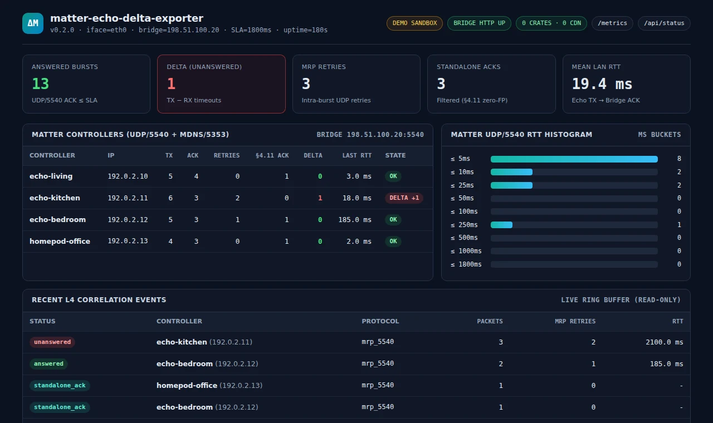
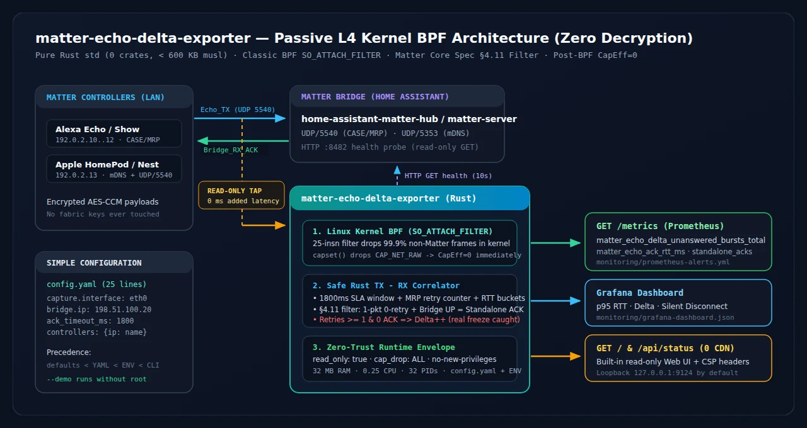

# matter-echo-delta-exporter

[](LICENSE)
[](https://www.rust-lang.org/)
[](Cargo.toml)
[](monitoring/prometheus-alerts.yml)

Passive Linux kernel BPF exporter in pure Rust (`0` external crates, static binary `< 1 MB`) that monitors **encrypted Matter (`UDP/5540`) and mDNS (`UDP/5353`) traffic without decrypting it**. Counts `Echo_TX - Bridge_RX_ACK` to catch frozen Matter bridges (`home-assistant-matter-hub`, `python-matter-server`) when HTTP healthchecks still return `200 OK`.

- **Technical write-up:** [Superviser Matter en L4/L7 avec BPF, Prometheus et Grafana](https://blog.ravindra-job.fr/iot/supervision-matter-l4-l7-bpf-prometheus-grafana/) · **Bridge setup:** [Déployer Home Assistant Matter Hub](https://blog.ravindra-job.fr/iot/deployer-home-assistant-matter-hub/) · **Changelog:** [`CHANGELOG.md`](CHANGELOG.md)



## Quick Start

### Option 1 - Zero-Hardware Demo (3 seconds, unprivileged)

```bash
docker run --rm --user 1000:1000 --cap-drop ALL --read-only \
  -p 127.0.0.1:9124:9124 ghcr.io/ravindrajob/matter-echo-delta-exporter:latest --demo --bind 0.0.0.0:9124
# Open http://127.0.0.1:9124 (UI) or http://127.0.0.1:9124/metrics (Prometheus)
```

### Option 2 - Live Kernel BPF Capture (`config.yaml` + Docker Compose)

```bash
git clone https://github.com/ravindrajob/matter-echo-delta-exporter.git && cd matter-echo-delta-exporter
cp config.yaml.example config.yaml   # set capture.interface, bridge.ip & controllers
docker compose up -d                 # pulls GHCR image (add --build to compile locally)
```

### Option 3 - Build From Scratch (`cargo`, 0 crates)

```bash
cargo test --release
cargo run --release -- --demo --bind 127.0.0.1:9124
```

## How It Works (Zero Decryption)



Matter operational traffic on `UDP/5540` is encrypted end-to-end (CASE), but its **Message Reliability Protocol (MRP, Matter Core Spec §4.11)** enforces a predictable transport pattern: when a controller (Alexa Echo, Apple HomePod, Google Nest) sends a command and the bridge is frozen, the controller emits 2 to 5 UDP retransmissions with **zero reply packet**.

- **25-instruction classic kernel BPF (`SO_ATTACH_FILTER`):** drops 99.9% of unrelated traffic inside the Linux kernel (`IPv4`, `IPv6`, `802.1Q` VLAN on `UDP/5540` & `UDP/5353`).
- **Matter Spec §4.11 Standalone ACK filter:** a single isolated `UDP/5540` packet (`packets == 1`, `retries == 0`) while the bridge HTTP endpoint is `UP` is counted as `matter_echo_standalone_acks_total` instead of a false alert.
- **Simple configuration (`config.yaml` < ENV < CLI):** one 25-line [`config.yaml.example`](config.yaml.example) with `${ENV_VAR}` expansion, optional `auto_discover_prefix`, and safe loopback binding (`127.0.0.1:9124`).

## Hardening & Security

- **Post-BPF capability drop:** `CAP_NET_RAW` is used solely to open/bind `AF_PACKET`, then cleared (`CapEff = 0`) via Linux `capset` before entering the capture loop.
- **Minimal container envelope:** `read_only: true`, `cap_drop: [ALL]`, `no-new-privileges:true`, `mem_limit: 32m`, `cpus: 0.25`, `pids_limit: 32`, zero `docker.sock`.
- **Read-only HTTP server:** `GET`/`HEAD` only, `0` external CDNs, strict `CSP`, `X-Frame-Options: DENY`, `nosniff`, and `no-store`. See [`SECURITY.md`](SECURITY.md).

## Prometheus & Grafana

Ready-to-import assets live in [`monitoring/`](monitoring/):

- [`monitoring/grafana-dashboard.json`](monitoring/grafana-dashboard.json): Bridge UP, Unanswered Delta, Standalone ACKs (§4.11), p95 RTT, and MRP retry streaks.
- [`monitoring/prometheus-alerts.yml`](monitoring/prometheus-alerts.yml): `MatterUnansweredMrpBurst`, `MatterBridgeSilentDisconnect`, `MatterBridgeHttpDown`, `MatterHighMrpRetries`.

| Metric | Type | Meaning |
| :--- | :--- | :--- |
| `matter_echo_delta_unanswered_bursts_total` | Counter | `TX - RX` bursts exceeding `ack_timeout_ms` (real outage) |
| `matter_echo_standalone_acks_total` | Counter | Healthy 1-packet §4.11 ACKs filtered out |
| `matter_mrp_retries_total` | Counter | Intra-burst UDP retransmissions before ACK/timeout |
| `matter_echo_ack_rtt_ms` | Histogram | Controller TX to Bridge ACK latency (`5 ms` to `1800 ms`) |
| `matter_silent_disconnect` | Gauge | `1` when bridge HTTP is UP >5m, mDNS arrives, 0 CASE replies |

Licensed under [MIT](LICENSE) - **Ravindra JOB**.
